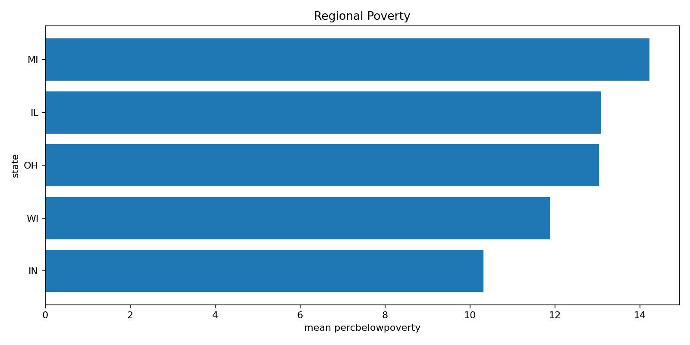

# Regional Poverty — executed results

## Decision question
How do county poverty percentages vary across states?

## Evidence
The largest observed mean percbelowpoverty is 14.225 for MI. This ranking is descriptive, not a recommendation.

Raw rows: 437. Rows used: 437. Excluded for missing/nonfinite required values or invalid denominator: 0.

## Method
Complete-case descriptive comparison of percbelowpoverty by state; show group counts, mean, minimum and maximum.

## Interpretation and limitations
Means weight counties equally, not people; historical county aggregates cannot describe individuals. No causal inference, significance claim or production deployment is implied. Missing values are not imputed; identical rows are retained. Small or repeated samples limit uncertainty interpretation.

## Recommended next decision
Recalculate population-weighted estimates using the correct poverty denominator.

## Reproducibility
Source and exact downloaded-byte SHA256 are recorded in run_manifest.json. SQL results are in answer.csv and analysis.sqlite. Review quality_audit.csv before interpretation.
